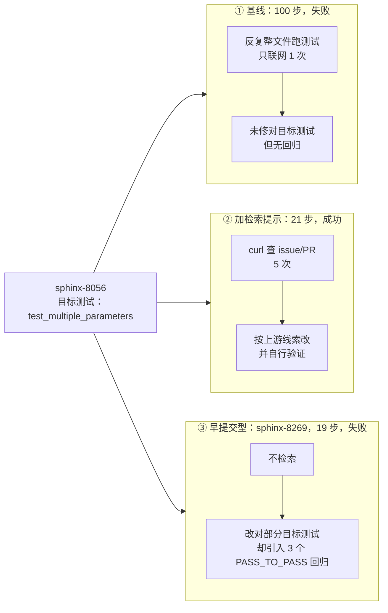

# 代表性轨迹（样例）

完整轨迹体积大（每条约 0.2–0.7 MB、全部 65 条约 26 MB），不适合全部入库。
这里只保留 3 条最有解释力的，覆盖三种典型结果。全量轨迹留在本地。

| 文件 | 来源 run | 步数 | 联网 | 结果 | 说明 |
|---|---|---:|---:|---|---|
| `01-capability-failure-8056.traj.json` | `baseline` | 100 | 1 次 | ❌ 失败 | doubao-lite 在 `sphinx-8056` 上第一次跑：花满 100 步仍未修对目标测试 `test_multiple_parameters`，且没有引入回归——属于"啃不动"型失败 |
| `02-retrieval-prompt-success-8056.traj.json` | `probes/retrieval-prompt` | 21 | 5 次 | ✅ 成功 | **同一题、同一模型**，只加了一段"先查 issue/PR 再动手"的提示：21 步解决，并用 `curl` 查阅上游修复作为线索后自行验证 |
| `03-early-submit-regressions-8269.traj.json` | `baseline` | 19 | 0 次 | ❌ 失败（3 个回归） | `sphinx-8269` 只 19 步就提交：目标测试部分通过，但弄坏了 3 个 `PASS_TO_PASS` 旧测试——"早提交/考虑不周"型失败 |

## 怎么读这些轨迹

`messages` 数组按时间顺序记录每一步：

- `role: assistant` → 模型的一次响应，`reasoning_content` 是它的思考，`tool_calls` 是它要执行的 bash 命令；
- `role: tool` → 容器执行结果（`<returncode>` + `<output>`，超长输出会被截断）；
- `role: exit` → 最终提交的 git patch。

快速查看某条轨迹执行过的命令：

```bash
uv run python - <<'EOF'
import json
t = json.load(open("examples/02-retrieval-prompt-success-8056.traj.json"))
for m in t["messages"]:
    for tc in m.get("tool_calls") or []:
        print(json.loads(tc["function"]["arguments"])["command"][:120])
EOF
```

## 三条轨迹的对照

同一基准、同一模型（`doubao-seed-2-1-lite`），差别只在"有没有检索提示 / 工具有没有被用起来"：



三条轨迹分别对应三类结论：**能力边界**、**检索的价值**、**早提交/回归的代价**（后者需要提交前自检 gate，而不是再加工具）。

## 三点观察（与 `../REPORT.md` 对应）

1. **同一模型、同一题，成败取决于策略而非能力**：01 与 02 只差一段检索提示，100 步失败 → 21 步成功。
2. **联网检索本身不是万灵药**：01 也联网 1 次，但时机晚、目标不准；03 完全不联网就匆忙提交。
3. **步数多 ≠ 更接近正确**：01 用了 02 的近 5 倍步数仍未通过，说明长尾步数未必是有效探索。
